

  

  

  
  
  
  
  

 


  


  <a href="https://github.com/0xr4j/mars-walk-planner"></a>
  <a href="https://github.com/0xr4j/rakshasutra"></a>

  <a href="https://github.com/0xr4j/ayawarden"></a>
  <a href="https://github.com/0xr4j/zerobleed"></a>

  <a href="https://github.com/0xr4j/dukaan-ai"></a>
  

  
  
  


  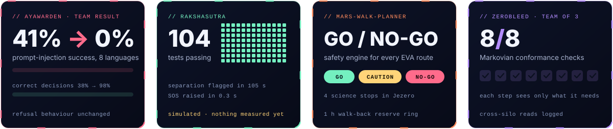


  


  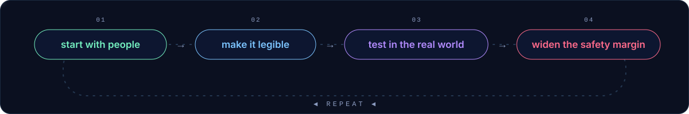

  

  

