<p align="center">
  
</p>

<p align="center">
  <a href="https://github.com/0xr4j"></a>
</p>

<p align="center">
  <a href="https://learn.arena.education/"></a>
  
  
  <a href="https://www.linkedin.com/in/raj-jha-22b13b333/"></a>
  
</p>

<br>

<p align="center">
  
</p>

## 🛰️ Shipped & building

<table>
<tr>
<td width="50%" valign="top">

### 🔴 [mars-walk-planner](https://github.com/0xr4j/mars-walk-planner)
Layered EVA planning map for the first astronauts on Mars — Jezero Crater with live NASA data (HiRISE, CTX, THEMIS, TES, MOLA), hazard zones, a **GO / NO-GO safety engine**, live space weather and a helmet HUD.

<a href="https://0xr4j.github.io/mars-walk-planner/"></a>


</td>
<td width="50%" valign="top">

### 📿 [rakshasutra](https://github.com/0xr4j/rakshasutra)
An open design for finding separated children and elders on a mountain pilgrimage route — **no phones, no cellular coverage**. Signed BLE wristbands, edge-filtering poles, LoRaWAN.


</td>
</tr>
<tr>
<td width="50%" valign="top">

### 🛡️ [ayawarden](https://github.com/0xr4j/ayawarden)
Tiny Aya that **ignores instructions hidden in its tools**, across 8 languages. CuratorKIT → SafeTune / SafeGrad → AuditKIT.


</td>
<td width="50%" valign="top">

### 🗣️ [dukaan-ai](https://github.com/0xr4j/dukaan-ai)
Shopkeepers run their whole business by **talking to their phone** — snap a product, speak an invoice, hear today's sales. An AI agent on PayPal's Agent Toolkit.


</td>
</tr>
<tr>
<td width="50%" valign="top">

### 🔐 [zerobleed](https://github.com/0xr4j/zerobleed)
A **need-to-know context broker** for agentic decisions — Zetaris + Meterless Markovian + Nightshift + NVIDIA Nemotron.

<a href="https://copyninja07-07.github.io/zerobleed/"></a>


</td>
<td width="50%" valign="top">

### 🔒 counter-drone · `[REDACTED]`
Part of a startup building **counter-drone systems**. The work is confidential, so there are no public repos, details or demos yet.


</td>
</tr>
</table>

## 🧰 Toolbox

<p align="center">
  
</p>

| Layer | Stack |
|---|---|
| 🧠 Deep learning | Python · PyTorch · einops · einsum |
| 🔬 Interpretability | TransformerLens · nnsight |
| 📏 Evals & experiments | Inspect AI · Weights & Biases |
| 📡 Edge & hardware | BLE · LoRaWAN · embedded sensing |
| 🛠️ Workflow | Colab · Jupyter · VS Code |

## ⚙️ How I build

```text
 people ─▶ legible ─▶ field-tested ─▶ safer ─┐
   ▲                                         │
   └──────────────── repeat ◀────────────────┘
```

## 📈 Activity

<p align="center">
  
</p>

<p align="center">
  
</p>
