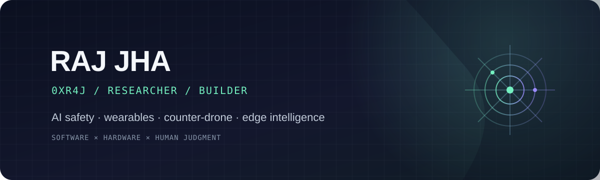

  

  
  
  

## Hey, I’m Raj <code>0xr4j</code>

COO at [@mth](https://github.com/mth) · Mathematics & Computing undergrad · Independent researcher

I’m interested in building intelligent systems that stay useful in the real world: close to the edge, attentive to people, and designed with safety in mind.

### Current orbit

- **Cognitive-assistive wearables** — interfaces that help people notice, understand, and act
- **Edge intelligence** — capable systems that work where the data and decisions happen
- **AI safety** — learning how to make increasingly capable systems more reliable and aligned
- **Flight controls** — exploring the boundary between autonomy, control, and human judgment

### How I like to build

`Start with people` → `make the system legible` → `test in the real world` → `improve the safety margin`

I’m happiest where software meets hardware, research meets prototypes, and ambitious ideas have to earn trust.

---

Curious by default. Safety in the loop. Always building toward useful.

